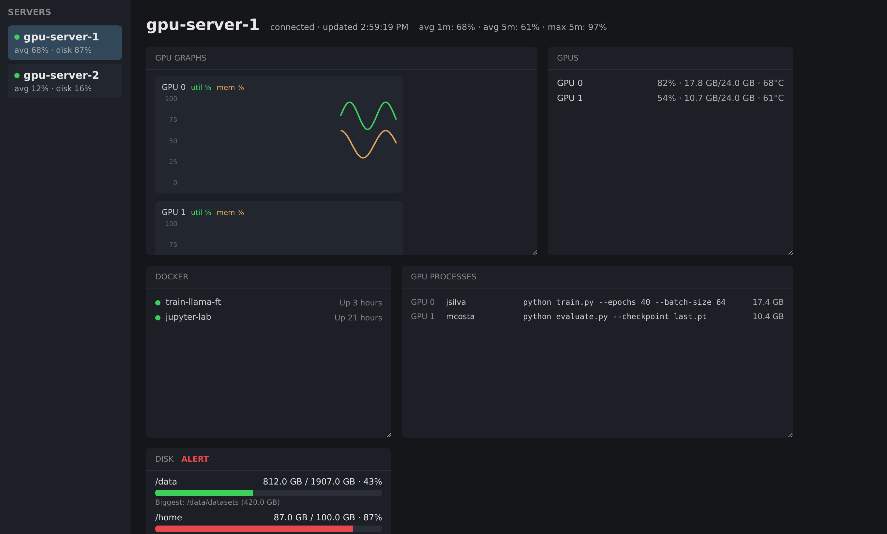

# nvtop-tracker

A lightweight, real-time GPU & disk monitoring dashboard for a handful of GPU servers. A small
exporter on each server collects GPU utilization/memory/temperature, MIG partitions, GPU
processes and their owners, disk usage and running containers; Prometheus stores it; the
dashboard reads Prometheus and streams updates to the browser. No SSH keys, no database of its
own.



```
 GPU server                              Prometheus host
 nvtop-exporter (127.0.0.1:19101) ──▶  Prometheus ◀── nvtop-tracker dashboard ──SSE──▶ browsers
                    scrape, or an agent's remote write      HTTP API every 2 s
```

## Features

- **Multi-server**: watch several GPU servers from one dashboard, switch focus from the sidebar.
- **Live GPU metrics**: per-GPU utilization, memory, and temperature, refreshed every couple of
  seconds with a rolling 5-minute history graph (filled from Prometheus right after a restart).
- **MIG partitions on any GPU**: each partition of a MIG GPU shows as `GPU <n> - <k>`, as soon as
  partitions appear and until MIG is turned off again. Utilization comes from DCGM
  (`nv-hostengine` must run on the server), otherwise `n/a`; a partition with unknown
  utilization is never counted as idle.
- **Jetson-style GPUs**: GPUs that share system memory (e.g. Jetson) show it as unified
  memory.
- **Idle timer & owners**: each GPU card shows how long it has been idle (`hh:mm:ss`, after
  1 minute below 1% utilization) or an "in use" tag, plus round avatars of the users currently
  running processes on it.
- **Idle history**: an extra card in the GPU graphs shows, per GPU, how long it was idle before it
  was last taken into use and its total idle time over the past 30 days. Idle periods only count
  after 10 minutes, and short bursts of activity (10 minutes or less) don't end them. The data is
  saved to `data/idle-history.json`, so it survives restarts.
- **Teams alerts**: optional. GPUs idle for 12 h or more are reported every 12 h in one batched
  message (servers with `idleAlerts: false`, e.g. inference-only, are left out); a server whose SSH
  access fails for 5 minutes gets an alert with hourly reminders and a recovery message when it is
  back.
- **Disk usage**: per-mount usage with a configurable alert threshold, plus a "biggest
  subfolder" scan for mounts you care about.
- **Containers & GPU processes**: running containers, and which processes (and users) are
  actually using each GPU.
- **Freely rearrangeable dashboard**: drag blocks to any position on a snap-to-grid, resize them
  from the corner handle — your layout persists in the browser.

## How it works

- **nvtop-exporter** (`src/exporter.js`) runs on each GPU server. It polls `nvidia-smi`, `ps`,
  `df`, `du`, DCGM (`dcgmi`, for MIG partitions) and the Docker Engine API on its own timers and
  serves the latest results on `/metrics`; a scrape never runs a command. Unknown values are
  left out (never reported as 0), and results older than a few poll intervals are dropped.
- **Prometheus** scrapes each exporter every 2 s and labels its series with `server="<name>"`.
  A server Prometheus cannot reach runs Prometheus in agent mode and remote-writes instead.
- **The dashboard** (`src/server.js`) queries Prometheus every 2 s. A server whose exporter has
  had no successful GPU poll for `staleAfterMs` shows offline.

## Requirements

- Node.js >= 18 for the dashboard and the exporter.
- A Prometheus the dashboard can query (basic auth supported).
- On each GPU server: `nvidia-smi`, `ps`, `df`, `du`; optionally `dcgmi` with `nv-hostengine`
  running (MIG partition utilization) and the Docker Engine API (containers list).

## Getting started

On a GPU server:

```bash
cp exporter.config.example.json exporter.config.json   # then edit it
npm run exporter                                       # http://127.0.0.1:19101/metrics
```

Point Prometheus at it, with the label the dashboard will use as the server name:

```yaml
scrape_configs:
  - job_name: nvtop
    scrape_interval: 2s
    static_configs:
      - targets: ["127.0.0.1:19101"]
        labels: { server: "GPU Server 1" }
```

Then the dashboard:

```bash
npm install
cp config.example.json config.json   # list the servers, set prometheusUrl
PROMETHEUS_USERNAME=... PROMETHEUS_PASSWORD=... npm start
```

Open `http://localhost:3000`. `config.json` and `exporter.config.json` are gitignored; set
`NVTOP_CONFIG` / `NVTOP_EXPORTER_CONFIG` to read them from another path.

## Deploying with Docker

One `Dockerfile` builds both images (`--target dashboard`, `--target exporter`); `deploy/` has two
compose projects. Hosts need Docker with the NVIDIA container runtime and a user in the `docker`
group (no sudo needed). Host-specific values (server name, data disks, the hub's address,
credentials) are passed to `init.sh`, which writes them only into gitignored files.

**Hub** (`deploy/hub`): the team's Prometheus on `:19090` (basic auth, 30-day retention, receives
remote hosts' writes), this host's exporter, a Docker socket proxy and the dashboard on `:13000`.
It is independent of any other monitoring stack on the host.

```bash
cd nvtop-tracker/deploy/hub
cp config.example.json config.json   # servers, avatars; keep teamsWebhookUrl empty until cut-over
./init.sh --name "GPU Server 1" --data-disk /data/disk1 --data-disk /data/disk2
docker compose up -d --build
```

**Remote hosts** (`deploy/remote`): for a host the hub cannot reach, its exporter and a
Prometheus agent that remote-writes to the hub. `--unified-memory` is for Jetson-style GPUs.

```bash
cd nvtop-tracker/deploy/remote
./init.sh --name "GPU Server 2" --hub-url http://<hub-host>:19090 --unified-memory
docker compose up -d --build         # init.sh asks for PROMETHEUS_PASSWORD from the hub's .env
```

**SSH probe** (`deploy/probe`): on a machine in the developers' network that reaches every
server, `blackbox_exporter` checks each server's SSH banner every 30 s (no key, no login) and a
Prometheus agent writes the results to the hub. They drive the Teams unreachable/recovery messages.

```bash
cd nvtop-tracker/deploy/probe
./init.sh --hub-url http://<hub-host>:19090 --target "GPU Server 1=<host-1>" --target "GPU Server 2=<host-2>"
docker compose up -d                 # init.sh asks for PROMETHEUS_PASSWORD from the hub's .env
```

`init.sh` remembers its options in `.env`, so re-running it needs none (`--new-password` rotates
the hub's password). Update a host with `git pull && docker compose build && docker compose up -d` (a single
`up -d --build` can leave a container on the old image with some Compose versions); logs with
`docker compose logs -f`. Exporters listen on `127.0.0.1` only; the containers list goes through a
proxy that allows `GET /containers/json` and nothing else, over a Unix socket. Where DCGM is
installed, the exporter uses the host's own `dcgmi`, so it always matches the host engine.

### Moving from the SSH deployment

1. Copy the old deployment's `data/` and `avatars/` into `deploy/hub/`, so idle history and Teams
   state carry over, then start the stacks with `teamsWebhookUrl` still empty (the old deployment
   keeps sending the alerts).
2. Run the parity check (below) against the old dashboard until runs come back clean.
3. In one sitting: stop the old service, copy `data/` again, set `teamsWebhookUrl` in
   `deploy/hub/config.json`, `docker compose restart dashboard`, and announce the new URL.

## Configuration

### Dashboard (`config.json`)

All fields are optional; anything you omit falls back to the default below (see `src/config.js`).

| Field | Default | Description |
|---|---|---|
| `servers` | `[]` | Array of `{ name, idleAlerts? }`. Each `name` must equal the `server` label of that host's series in Prometheus. `idleAlerts: false` (e.g. an inference-only server) keeps it out of Teams idle alerts and idle card colors. |
| `port` | `3000` | Port the dashboard listens on. |
| `prometheusUrl` | `http://127.0.0.1:19090` | Prometheus to read from. Basic-auth credentials come from the `PROMETHEUS_USERNAME` / `PROMETHEUS_PASSWORD` environment variables, never from the file. |
| `gpuPollIntervalMs` | `2000` | How often to query Prometheus. |
| `gpuHistoryMinutes` | `5` | Length of the rolling GPU history used for graphs/trends. |
| `staleAfterMs` | `10000` | A server whose exporter has had no successful GPU poll for this long shows offline. |
| `diskStorageAlertThreshold` | `85` | Usage percent (per mount) that triggers the alert badge. |
| `userAvatars` | `{}` | Map of Linux username → profile picture path (relative to the repo root, or absolute), e.g. `{ "jsilva": "avatars/jsilva.png" }`. Unmapped users get an initials badge. The `avatars/` folder is gitignored. |
| `idleHistoryFile` | `data/idle-history.json` | Where idle history is saved (relative to the repo root, or absolute). Written every minute and on shutdown. The `data/` folder is gitignored. |
| `teamsWebhookUrl` | `""` | Teams Workflows webhook URL for idle-GPU and unreachable-server alerts (see [Teams notifications](#teams-notifications)). Empty disables them. |

### Exporter (`exporter.config.json`)

See `src/exporterConfig.js` for every default.

| Field | Default | Description |
|---|---|---|
| `listenHost` / `listenPort` | `127.0.0.1` / `19101` | Where `/metrics` is served. Keep it off the network; only Prometheus needs it. |
| `gpuPollIntervalMs` / `diskPollIntervalMs` | `2000` / `300000` | GPU (and process, MIG) polling; disk and containers polling. |
| `diskMountPrefixes` | `null` | Only mounts equal to or under one of these are reported; `null` reports every real mount and `[]` none. In a container, set it so the container's own bind mounts stay out. |
| `diskTopFolderMountPrefixes` | `["/data"]` | Mounts to run the "biggest subfolder" `du` scan against. |
| `duTimeoutSeconds` | `25` | Time limit for the `du` scan; a slow/huge filesystem just reports the biggest folder found so far. |
| `dockerHost` | `unix:///var/run/docker.sock` | Docker Engine API for the containers list (`unix:///path` or `http://host:port`); only `GET /containers/json` is used, so a socket proxy that allows nothing else works. Empty disables it. |
| `unifiedMemoryFallback` | `false` | For GPUs that report memory as `[N/A]` (Jetson), report `/proc/meminfo` instead. |
| `gpuQueryCommand`, `diskQueryCommand`, `gpuUuidQueryCommand`, `gpuProcessesQueryCommand`, `migQueryCommand`, `dcgmDiscoveryCommand`, `dcgmActivityCommand` | — | The exact commands used to collect each kind of data, in case you need to adapt them. |

MIG partitions are read from `nvidia-smi -q -x`. Where that output shows MIG enabled but lists no
partitions (as in a container without the MIG monitor capability) or cannot be read, the
partition layout and memory come from DCGM instead, and the GPU's processes stay listed on the
whole GPU.

## Teams notifications

Set `teamsWebhookUrl` (empty disables them) to a Teams Workflows webhook:

1. In the Teams channel, click "..." and choose Workflows.
2. Pick "Send webhook alerts to a channel".
3. Set the trigger access to "Anyone".
4. Copy the full URL into `teamsWebhookUrl` in `config.json`. On zsh, make sure
   the pasted URL contains no `\` (zsh adds one before `=` and `?`).

The URL is a secret: it is never logged or sent to the browser. Sent-message state is kept in
`notifier-state.json` next to the idle history, so a restart does not repeat alerts. When
Prometheus cannot be queried, no server is reported down and no idle alert is computed from old
data.

The unreachable/recovery messages watch SSH access: an SSH probe agent (`blackbox_exporter`, no
key, it only checks the `SSH-2.0-` banner) on a machine that reaches every server writes
`nvtop_ssh_up` per server into Prometheus. Stale exporter data only shows on the dashboard.

## Development

```bash
npm test
```

Tests cover the parsers, the exporter's polling (including MIG on any GPU and the DCGM
fallback), the metrics it renders, the dashboard's Prometheus reading, idle history and Teams
notifications — no live servers required.

### Parity check

While the SSH-based dashboard and this one run side by side, `npm run parity` compares them on
live data with Playwright (Chromium): per server, GPU entries and MIG partitions, utilization
(1-minute means), memory and temperature within tolerances, status pills and idle times, owners, processes,
containers and disks, as received and as rendered.

```bash
OLD_URL=http://old-dashboard-host:3000 NEW_URL=http://gpu-server-1:13000 npm run parity
```

Defaults to 30 minutes with a round every 30 s (`PARITY_MINUTES`, `PARITY_INTERVAL_S`;
`PARITY_ROUNDS=1` for a quick check). A mismatch only counts when it shows in two consecutive
rounds (containers and disks, which both boards poll every 5 minutes: when it outlasts a poll); known differences (a unified-memory GPU only on the new board, the biggest folder, the live idle timer of a GPU with short bursts) are reported
but don't fail the run. Set `PARITY_SKIP_IDLE_TIME=1` until both boards share the same idle
history. The report (`report.html`, `report.json`, screenshots) goes to `parity-report/`.

The design docs under `docs/superpowers/specs/` have more detail on the architecture decisions,
in particular `2026-10-28-prometheus-source-design.md` for this exporter/Prometheus design.

## License

MIT — see [LICENSE](LICENSE).
